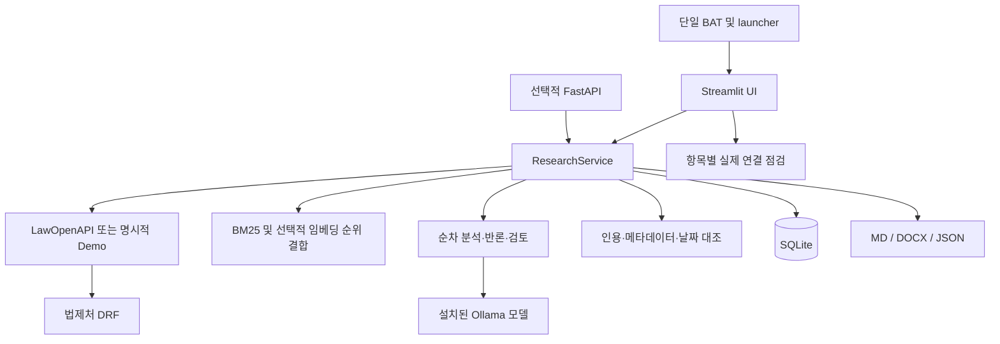

# 개발명세서 — Korean Legal Research Studio

문서 기준일: 2026-11-11 (Asia/Seoul)  
대상 버전: v0.2 개발판 및 현재 로컬 개선사항  
문서 성격: 현재 소스와 실제 확인 결과에 기반한 구현 명세. 미구현 요구사항은 별도 명시.

## 1. 목적과 성공 기준

공식 법령·판례 원문을 조회하고 근거·반론 후보를 정리해, 검토자가 출처를 추적할 수 있는 조사 초안을 만든다. 단일 사용자 PC에서 실행하며 결과 문서를 통한 협업을 기본으로 한다.

### 현재 릴리스의 성공 기준

1. BAT 하나로 앱이 기동되고 서버 준비 확인 후 브라우저를 연다.
2. 공식 API 인증값과 설치된 Ollama 모델로 실제 조회·추론을 실행한다.
3. 원문이 없는 주장이나 인용 불일치를 정상 근거로 채택하지 않는다.
4. 자료 수집과 단계별 결과를 저장해 중단 후 마지막 저장본을 읽을 수 있다.
5. 공식 자료·가상 자료·업로드 자료의 출처를 구분한다.
6. 검토자가 검색어·원문·제외 사항·조사 범위를 보고 결과를 평가할 수 있다.

법률 정확도 목표치는 아직 설정할 수 없다. 전문가 정답셋과 평가 절차를 만든 뒤 기준선을 측정해야 한다.

## 2. 사용자와 협업 책임

| 사용자 | 수행 업무 | 산출물 |
|---|---|---|
| 조사 담당자 | 질문·사실관계 입력, 검색·본문 수집, 초안 생성 | 출처가 연결된 조사 결과 |
| 담당 변호사·법무 담당자 | 요건·문맥·사건 적용·불리한 자료 확인 | 최종 검토 의견 |
| 선임 검토자 | 검색 누락과 인용 적정성 확인, 보완 지시 | 문서 댓글·추가 조사 요청 |
| 로컬 운영자 | 환경변수·모델·백업 관리 | 사용 가능한 로컬 환경 |

현재 앱에 역할별 계정과 권한은 없다. 이 표는 실제 업무 분담이며 소프트웨어 권한 체계가 아니다. 내부 승인·반려·공동 편집 기능은 미구현이다.

## 3. 현 상태 평가

아래 점수는 현재 코드를 바탕으로 한 주관적 개발 평가다. 외부 인증·법률 정확도 점수·경쟁 서비스 비교 점수가 아니다. 평가 기준은 10점 만점이다.

| 항목 | 점수 | 근거 |
|---|---:|---|
| 개발 난이도 | 7/10 | 공식 API XML, 로컬 모델, 인용 대조, 복수 조사 역할, SQLite 저장, 두 실행 인터페이스, Windows 운영을 연결 |
| 내부 조사 보조 실용도 | 6/10 | 원문 수집·검토서 출력·인용 추적은 가능. 검색 품질과 업무별 정답 평가·재시도·협업 제어가 부족 |
| 공개 서비스 준비도 | 3/10 | 인증·권한·다중 사용자·작업 큐·보존정책·운영 관측 체계 미구현 |
| 법률 정확도 | 미평가 | 전문가 검토 정답셋과 실질적 법리 지지·반대 판정 평가 없음 |

난이도는 일반적인 개인용 CRUD·채팅 앱보다 복잡한 통합 작업이라는 기준이다. 실용도는 변호사 검토를 전제로 반복 조사 시간을 줄이는 용도로 평가했다. 전면적인 법률 리서치 대체 도구의 완성도는 더 낮다.

## 4. 시스템 구성



### 모듈 책임

| 경로 | 책임 |
|---|---|
| `Legal-Research-Studio.bat` | 가상환경 확인·최초 설치·단일 실행 진입점 |
| `legal_studio/launcher.py` | 실행 명령 분기, 준비 상태 확인, 브라우저 열기, 서버 종료 처리 |
| `ui.py` | 7개 업무 탭, 모델 선택, 진행 표시, 기록 조회 |
| `config.py` | 환경변수, 프로젝트 기준 경로, 원격 Ollama 허용 경계 |
| `model_catalog.py` | 설치 모델·기능 조회 및 기본 모델 선택 |
| `connection_checks.py` | 항목별 실제 연결·응답 검사 |
| `sources.py` | 공식 XML 요청, 파싱, 검색 정렬, 제한된 재시도 |
| `retrieval.py` | 한국어 토큰·BM25, 관련 구간, 임베딩·RRF |
| `research.py` | 조사 흐름, 원문 합치기, 단계 기록·체크포인트 |
| `agents.py` | 역할별 프롬프트, 인용 검증을 거친 결과, 검토서 구성 |
| `analysis.py` | 판결문 제목·섹션 추출과 선택적 AI 분석 |
| `verifier.py` | 원문 문구·위치·해시, 사건 정보, 기준일 대조 |
| `db.py` | 캐시·작업·로그·작업별 스냅샷, FTS5 |
| `documents.py` | 크기가 제한된 로컬 텍스트 추출 |
| `reporter.py` | 공통 보고서 절과 MD·DOCX 출력 |
| `browser_tasks.py` | 공식 사이트 탐색 요청과 CLI 가이드 확인 |
| `api.py` | 동기 REST 요청, 검증·오류 응답·출력 |
| `doctor.py` | CLI 환경·선택 모델·실제 연결 진단 |

## 5. 기능 요구사항 및 수용 기준

### FR-01 단일 실행

**구현:** BAT 하나만 유지. 가상환경이 없을 때 생성·설치한다. 기본 실행은 Streamlit을 127.0.0.1:8514에 띄우고 최대 60초 준비 상태를 기다린다. 준비 확인 뒤 브라우저를 연다. 기존 서버가 응답하면 다시 기동하지 않는다.

**수용 기준:** 기본 명령에 메뉴 입력이 없어야 한다. 준비 확인 실패나 프로세스 조기 종료 시 실패를 알린다. 종료 시 자신이 띄운 자식 프로세스에 종료 요청 후 제한 시간 경과 시 강제 종료한다.

**현재 한계:** 기존 포트의 Streamlit 건강 응답만 확인하며 프로젝트 고유 인스턴스 ID를 확인하지 않는다. Ollama 자동 실행·모델 자동 다운로드는 하지 않는다.

### FR-02 설치 모델 선택

**구현:** `/api/tags`의 설치 목록 및 `/api/show` 기능을 조회한다. 채팅은 completion, 임베딩은 embedding으로 분리한다. 설치된 선호 모델, 아니면 가장 작은 설치 용량 모델을 선택한다. UI 선택 변경과 새로고침을 지원한다.

**수용 기준:** 모델명 고정값이 없어야 한다. 없는 선호 모델을 호출하지 않아야 한다. 임베딩 기능 모델을 채팅 기본값으로 고르지 않아야 한다. 해당 모델이 없으면 비활성 상태를 설명한다.

**현재 한계:** 성능·법률 정확도·RAM 가용량을 기준으로 최적화하는 선택 알고리즘은 아니다. 목록 조회 일부 오류가 전체 빈 목록으로 처리될 수 있다. UI 목록은 30초 캐시한다. 독립 API 서버는 UI 선택값을 공유하지 않는다.

### FR-03 법령 검색과 조문

**구현:** 공식 API 후보 최대 100건을 읽고 공백·대소문자 정규화한 이름 완전 일치, 이름 시작 일치, 이름 순으로 정렬한다. 정렬 뒤 요청 건수 상한을 적용한다. 조문·시행일·부칙을 추출한다.

**수용 기준:** API가 난민법을 먼저 반환해도 민법 완전 일치 후보가 있으면 민법을 먼저 반환한다. 1건 요청에서도 정렬이 먼저 적용된다. 원문 형식 오류는 빈 법령으로 은폐하지 않는다.

**현재 한계:** API 첫 100건 밖은 검색하지 않는다. 사건 발생일 기준 법령 버전 선택·개정 전후 비교·부칙 적용 판단은 미구현이다. 상세 추출은 정규화 텍스트이며 원래 편집 구조를 모두 재현하지 않는다.

### FR-04 판례 목록과 본문

**구현:** 공식 목록·본문 API를 사용한다. 목록에는 `datSrcNm=대법원`을 명시한다. 검색어·본문/참조판례 검색·페이지·법원·사건번호·날짜 범위를 처리한다. 상세는 판례 일련번호 ID로 XML 본문을 조회한다.

**수용 기준:** 실제 목록의 ID로 사건번호와 본문을 읽을 수 있어야 한다. 데이터 제공기관 범위를 UI와 문서에 표시한다. HTML 전용 또는 미제공 XML을 정상 판결문으로 취급하지 않는다.

**현재 한계:** 국세청 HTML 전용 자료는 자동 분석 검색에 포함하지 않는다. 제공기관 대법원은 판결 법원이 대법원인 경우만 의미하지 않는다. 후속 판례·상급심·변경·폐기 자동 추적은 없다.

### FR-05 검색 순위

**구현:** 한국어 문자 bigram과 단어 토큰을 이용한 BM25를 기본 사용한다. 설치된 임베딩 모델을 선택하면 `/api/embed` 결과의 cosine 순위와 BM25 순위를 RRF로 결합한다. 임베딩 오류는 경고 후 키워드 순위로 대체한다.

**수용 기준:** 임베딩 장애가 원문 검색 전체 장애로 이어지지 않는다. 결과에 사용 방법과 점수를 표시한다. 점수를 법률적 확률로 설명하지 않는다.

**현재 한계:** 공식 API로 확보한 후보 내 순위다. 전체 판례 벡터 DB·지속 임베딩 인덱스·법률 특화 리랭커는 없다. 한 유사도 호출의 검색어 최대 4개, 기본 판례 본문 최대 12개로 제한한다.

### FR-06 통합 조사와 역할

**흐름:** 계획 → 법령 수집 → 판례 수집·순위 → 선택적 반론 후보 → 판결문 구조 → 선택적 법률 분석·반론·비판 검토 → 인용·날짜 대조 → 검토서.

계획과 검색은 결정적 애플리케이션 로직이다. 모델에게 브라우저·셸·임의 네트워크 도구를 주지 않는다. quick은 AI 최대 1회, research/deep은 선택 조건에 따라 최대 3회 순차 실행한다. 검토서 구성은 검증 결과를 사용하며 최종 미검증 LLM 합성 호출을 하지 않는다.

**수용 기준:** AI 비활성 역할은 SKIPPED로 남긴다. 원문이 없으면 추정 결론을 만들지 않는다. 실패·누락·제외 인용을 결과에 남긴다.

**현재 한계:** 모델 주도 쟁점 분해·적응형 재검색·충돌 중재·swarm은 없다. Deep 추가 검색도 제한된 규칙 기반이다.

### FR-07 인용 및 시점 검증

**구현:** 인용 문구의 정규화 원문 일치, 위치와 해시를 기록한다. 사건번호·법원·선고일을 API 메타데이터와 대조한다. 기준일 뒤 자료의 인용은 적용 근거에서 배제한다.

**수용 기준:** 불일치 인용은 일반 근거 목록에 들어가지 않아야 한다. 검증 상태와 한계를 표시한다. 업로드 문서는 공식 자료로 승격하지 않는다.

**현재 한계:** 인용문이 주장을 실제로 지지하는지, 문맥이 반대인지, 일부 요건을 전체 요건으로 확장했는지 판단하는 법률 entailment 검증은 아니다.

### FR-08 진행 표시와 중간 저장

**구현:** `on_progress` 콜백으로 현재 단계·단계 진행률·경과 시간·원문 수·저장 시각을 UI에 전달한다. 단계 경계 및 판례 원문 추가 시 결과를 저장하고, 캐시 설정이 켜져 있으면 작업별 원문 스냅샷을 보존한다.

단계 배정값: 계획 5, 법령 10, 판례 25, 반론 45, 구조 분석 60, AI 역할 65부터 역할별 +7, 인용 대조 90, 검토서 95, 완료 100. 실패 시 마지막 진행률을 유지한다.

**수용 기준:** UI 통지 전에 DB 결과가 저장되어야 한다. 완료 전에도 확보 원문과 스냅샷을 확인할 수 있어야 한다. 이전 JSON 기록은 새 필드 기본값으로 읽는다.

**현재 한계:** 진행률은 처리량 측정값이 아니다. 호출 중 heartbeat는 없고 표시 경과 시간은 저장 시점 기준이다. 마지막 체크포인트 조회만 가능하며 자동 재개·취소·부분 재시도·작업 큐는 없다. 비정상 종료 상태를 자동으로 중단 상태로 전환하지 않으므로 비종결 상태는 진행 중 또는 중단일 수 있다.

### FR-09 실제 연결 점검

**구현:** 설정·로그 탭의 점검은 네 항목을 독립 처리한다. 법령은 민법 완전 일치 및 조문, 판례는 본문, 채팅은 가상 점검 문서의 JSON·인용 대조, 임베딩은 유효 벡터를 확인한다.

**수용 기준:** 하나의 실패가 다음 항목 결과를 숨기지 않는다. 미설정과 호출 실패를 구분한다. 인증값·인증 포함 URL·서버 원문 오류를 화면에 그대로 반사하지 않는다.

**현재 한계:** 결과는 현재 세션의 마지막 점검값이며 지속 모니터링이 아니다. CLI doctor는 별도 진단이며 동일한 검사 깊이를 보장하지 않는다. 연결 성공과 법률 품질 합격은 다르다.

### FR-10 파일과 보고서

**구현:** PDF·DOCX·TXT·MD 추출, 구조 분석·인용 확인. MD·DOCX·JSON 결과 출력. 보고서에 검색어·검색 범위·선택 모델·미검토 상태·현재 단계·제외 사항을 기록한다.

**제한:** 입력 12MiB, PDF 80쪽, 추출 텍스트 130,000자. DOCX 압축 항목 최대 500개, 총 비압축 크기 40MiB. OCR·암호화 PDF·HWP/HWPX 입력·PDF/HWPX 출력 미지원. LLM에는 관련 구간을 선택해 총 16,000자 예산으로 전달하므로 문서 전체 의미 분석을 보장하지 않는다.

**수용 기준:** 초과·암호화·빈 텍스트는 명확히 알린다. 보고서가 인용 일치와 법적 타당성을 구분한다. 업로드 원본 파일의 자동 DB 저장은 하지 않는다.

## 6. 데이터 계약과 저장 구조

### 핵심 모델

| 모델 | 주요 필드 |
|---|---|
| StatuteHit / StatuteDetail | source_id, 법령명, 시행일, 출처 URL, 조문·부칙 |
| PrecedentHit / PrecedentDetail | source_id, 사건번호·사건명·법원·선고일, 요지·본문 |
| ResearchRequest | question, 법령·판례 검색어, mode, max_cases, enable_llm, position, counterarguments, semantic_search, as_of |
| Claim | text, source_id, quote, status, reason, role, locator, source_hash, temporal_status |
| AgentStep | role, status, detail, source_ids, started_at, finished_at |
| ResearchResult | job_id, question, status, sources, claims, warnings, steps, analyses, request, memo |
| 진행·출처 추가 필드 | current_stage, progress, checkpoint_at, elapsed_seconds, research_context |

`AgentStep.started_at` 필드는 존재하지만 현재 수행 기록에서 실제 시작 시간이 모두 채워지는 것은 아니다. 단계 상세 시간 측정 기능으로 해석하지 않는다.

`ResearchRequest` 제약: 질문 3~3,000자, 검색어 각각 최대 150자, 판례 요청 1~20건(내부 기본 수집은 최대 12건), 주장 최대 2,000자. `as_of`는 날짜 검증을 거친다.

### SQLite 테이블

| 테이블 | 키와 내용 | 갱신 방식 |
|---|---|---|
| documents | document_key = 출처유형:자료종류:ID, 본문·메타데이터·해시 | 최신 수신값으로 upsert |
| documents_fts | document_key, title, content | FTS5 지원 시 갱신. 미지원 시 대체 검색 |
| research_jobs | job_id, 질문·상태·결과 JSON, 생성·갱신 시각 | 체크포인트마다 갱신 |
| event_logs | id, job_id, action, message, 시각 | 추가 기록 |
| source_snapshots | (job_id, source_id), 본문·메타데이터 | 최초 insert, 작업 내 불변 |

외래키와 busy timeout을 사용하며 연결 컨텍스트 종료 시 commit/rollback 후 명시적으로 close한다. Windows 파일 핸들이 남던 문제를 수정했다. 캐시·스냅샷 비활성 상태에서도 질문·결과 발췌·인용은 작업 JSON에 남는다.

시각은 저장 코드의 UTC ISO 형식을 사용한다. 화면의 저장 시각은 한국 현지 시각으로 자동 변환된 값이 아닐 수 있다. SHA-256은 정규화 분석 본문 기준이며 원시 API 응답의 전자서명 검증이 아니다.

### 상태 전이

```text
PLANNING → RETRIEVING → ANALYZING → VERIFYING → COMPLETED 또는 PARTIAL
      각 처리 단계에서 예외 발생 → FAILED
```

강제 종료는 예외 처리나 종결 상태 저장을 통과하지 못할 수 있다. PARTIAL은 경고 또는 원문 부족을 포함한다. COMPLETED는 흐름 완료이며 법률 검수 완료 상태가 아니다.

## 7. API와 외부 연동

REST API는 127.0.0.1:8800, 동기 호출 방식이다. [상세 엔드포인트](API.md)를 참조한다. 기본 앱 실행과 별개 프로세스이며 UI 세션의 선택값을 공유하지 않는다.

- 공식 DRF: HTTPS lawSearch.do / lawService.do, 요청당 timeout 18초, 지정 HTTP 상태(429/502/503/504)에 최대 3회 시도
- 모델 목록·정보: HTTP 요청 timeout 5초
- Ollama 채팅: timeout 115초, 비스트리밍 JSON, temperature 0, num_predict 1200, think false
- Ollama 임베딩: timeout 90초, truncate false, 벡터 개수·차원·유한 수치 확인
- API 직접 원문 요청 오류: 503 / 요청 검증 오류: 422 / 필수 모델 없음: 400 / 작업 없음: 404
- 복합 조사 내부 실패는 결과의 상태·경고에 보존하므로 HTTP 성공만으로 전체 조사 성공을 판단하지 않음

기본 타임아웃은 단일 요청 경계다. 여러 원문과 역할을 순차 호출하므로 전체 작업은 더 오래 걸릴 수 있다. 작업별 전체 시간 제한·자동 API quota 제어는 없다.

## 8. 보안·운영 범위

구현 사항: 루프백 바인딩, 원격 Ollama 명시적 허용, XML 안전 파싱, 인증 URL 로그 방지, 자동 리다이렉트 거부, SQL 값 바인딩, 가상·공식 자료 분리, 업로드 크기·압축 크기 제한.

미구현 사항: 사용자·API 인증, 역할별 권한, 저장 암호화, 자동 민감정보 마스킹, 자료 보존기간·자동 삭제, 사용자별 DB 격리, 백그라운드 큐, 서비스 수준 rate limit, 다중 사용자 감사 체계.

`.env`·DB·가상환경은 Git 제외다. 백업에는 키와 사건 정보가 포함될 수 있으므로 권한을 관리한다. 원격 Ollama를 허용하면 질문과 원문이 해당 서버로 전송될 수 있다. 앱의 로컬 실행이 완전한 네트워크 단절을 뜻하지 않는다. 공식 API 조회에는 외부 연결이 필요하다.

## 9. 검증 증거와 미검증 범위

기준: 현재 세션에서 수행·관찰한 결과. 과거 문서의 59개 테스트·실연동 미확인 표현은 이 절로 갱신한다.

| 항목 | 확인 결과 | 해석 한계 |
|---|---|---|
| 자동 테스트 | Windows / Python 3.14.4, 63개 통과 | 대부분 모의 응답·결정적 로직. 실제 법률 정확도 지표 아님 |
| 법령 실연결 | 민법 완전 일치, 조문 1,193개 수신 | 조회 당시 응답, 법령 적용 적합성 검증 아님 |
| 판례 실연결 | 실제 검색 및 본문 수신, 예시 6,914자 | 전체 검색 결과와 모든 사건 유형 검증 아님 |
| 채팅 실연결 | 설치된 모델 자동 선택, JSON·점검 문구 대조 성공 | 한국 법률 지식·추론 정확도 미평가 |
| 임베딩 | 모의 프로토콜·수치 검증·오류 대체 테스트 | PC에 임베딩 모델 미설치, 실제 품질 미검증 |
| 실행 화면 | 서버 재시작, 화면·설정 점검 항목 확인 | 전체 화면·모든 사용자 경로의 브라우저 회귀 검사는 아님 |
| 중간 저장 | 완료 전 원문과 저장 상태 콜백 자동 테스트 | OS 강제 종료·디스크 부족·장기 동시 작업 시험 미수행 |
| CI | Windows/Linux Python 3.11/3.13/3.14 workflow 존재 | 원격 GitHub Actions 실행 성공 확인 아님 |

`requirements-tested.txt`는 과거 Linux 환경의 직접 패키지 버전 기록이다. 현재 Windows의 전체 의존성 잠금 파일로 간주하지 않는다. 모델명·본문 크기·조문 개수는 실행 시점에 달라질 수 있다.

검증 명령:

```powershell
.\Legal-Research-Studio.bat test
.\Legal-Research-Studio.bat verify
.\.venv\Scripts\python.exe -m compileall -q legal_studio ui.py
```

## 10. 향후 개발 명세

아래는 계획이며 현재 구현으로 표시하지 않는다.

| 우선순위 | 작업 | 완료 기준 |
|---|---|---|
| P0 | 전문가 검토 벤치마크 | 대표 질문 20~30개, 필수 출처·허용 결론·검토자 기록, 분리 평가셋과 오류 분류 |
| P0 | 업무별 검색 평가 | 판례 검색 precision/recall 기준선, 임베딩 전후 비교, 데이터 제공 범위별 누락 기록 |
| P1 | 판례 비교와 사람 검토 | 사실·쟁점·판단·차이·불리한 부분의 근거별 표, 미검토/채택/제외 및 사유·검토자 기록 |
| P1 | 작업 복구 | 취소 요청, 호출 경계 취소, 재실행 시 상태 확인, 완료 단계 재사용·실패 단계 재시도 |
| P1 | 역사적 법령 | 사건일 버전 선택, 전후 조문 비교, 부칙·경과규정 원문 근거 및 적용 확인 절차 |
| P1 | 후속 판례 관계 | 관계 후보와 실제 변경·폐기·구별 판단 구분, 검토 근거·사람 확인 |
| P2 | 문서 확대 | OCR 정확도 평가, HWPX 입력·출력, PDF 보고서, 페이지 단위 출처 연결 |
| P2 | 지속 검색 인덱스 | 출처 버전·임베딩 모델 버전·재색인 정책, 캐시 일관성 시험 |
| P2 | 협업 서비스화 | 인증·권한·사용자 격리·보존정책·작업 큐·운영 관측, 배포 전 검증 |
| P2 | ego 자동 수입 | 브라우저 발견 ID를 공식 API로 재조회, 출처 등급 구분, 로그인·CAPTCHA 사용자 인계 |

### 벤치마크의 최소 설계

분야별 질문·검색어·사실관계·사건 기준일·필수 근거·허용할 답변 범위를 사람이 작성한다. 정답에는 법령·판례 ID와 특정 원문 구간을 포함한다. 원문 인용 일치율, 필수 근거 검색 재현율, 상위 결과 정밀도, 근거 없는 주장 비율, 법리 지지 판정의 적정성, 누락 경고, 처리 시간·실패율을 구분해 측정한다.

모델·프롬프트·검색 설정·원문 조회일을 평가 실행마다 고정·기록한다. 품질 합격선은 첫 기준선 측정과 전문가 검토 후 결정한다. 자동 문구 일치율을 법률 정답률로 대체하지 않는다.

## 11. 문서 유지 규칙

실행법은 README, 현재 구현·수용 기준은 본 문서, API 계약은 API.md를 기준으로 갱신한다. 과거 개발 기록과 테스트 문서는 역사적 결과로 보존하되 현재 검증과 혼동하지 않도록 기준일을 표시한다. 새 기능은 코드 경로·검증 증거·한계를 함께 갱신하고, 미구현 항목을 구현 항목으로 옮길 때 완료 기준 충족을 확인한다.
